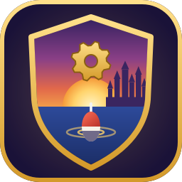
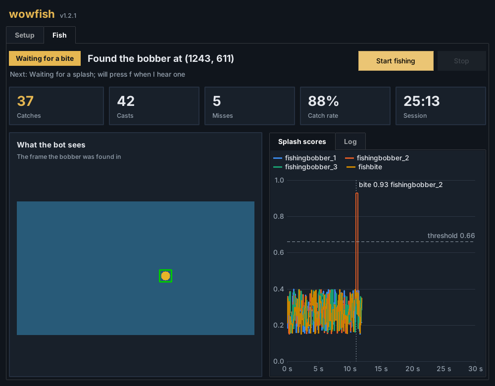
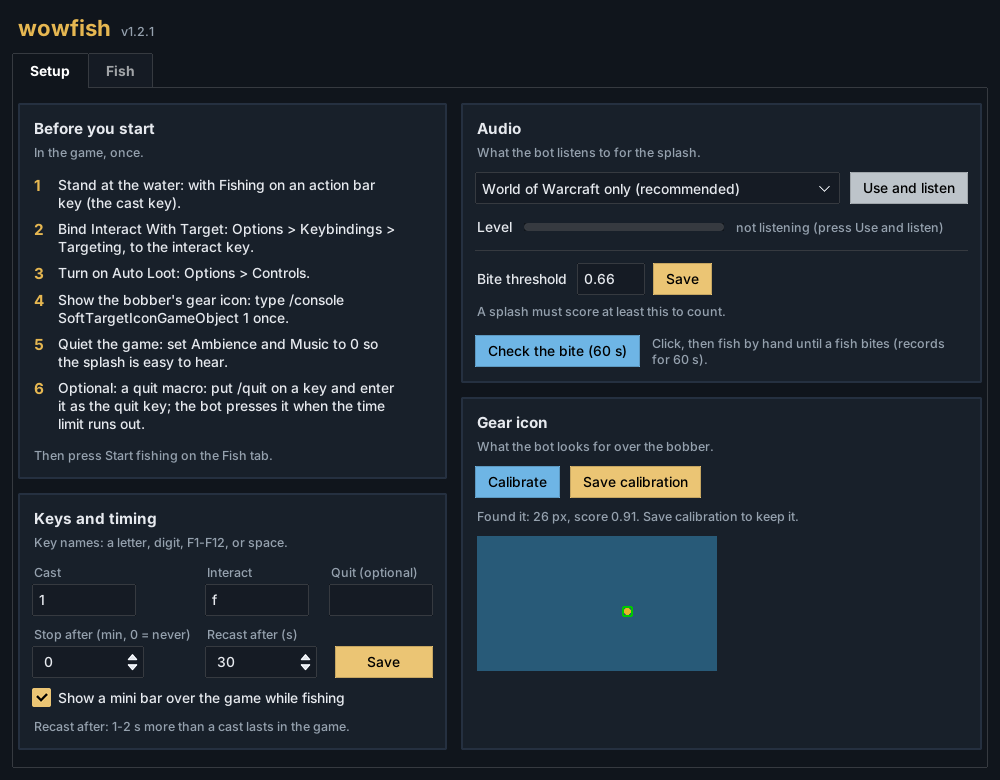

<div align="center">



<h1>WoW Fishing Assist</h1>

<p><strong>Hands-free fishing for World of Warcraft.</strong><br />
It watches for your bobber, listens for the splash, and loots the catch.</p>

<p>
  <a href="https://github.com/krasovsky22/WowFishingAssist/actions/workflows/ci.yml"></a>
  <a href="LICENSE"></a>
  
  
</p>

<p>
  <a href="#features"><b>Features</b></a> ·
  <a href="#quick-start"><b>Quick start</b></a> ·
  <a href="#set-up-the-game"><b>Set up the game</b></a> ·
  <a href="#settings"><b>Settings</b></a> ·
  <a href="#commands"><b>Commands</b></a> ·
  <a href="#how-it-works"><b>How it works</b></a>
</p>



</div>

> [!CAUTION]
> **Use at your own risk.** Automating gameplay breaks Blizzard's terms of service and can get
> your account banned. Blizzard's anti-cheat (Warden) is known to look at window titles and
> process names, so running from source under a name of your own is safer than the prebuilt
> `wowfish` executables. This project is for educational purposes.

## Features

**Fishing**
- 🎣 **Casts, spots the bobber, hears the bite, loots.** No memory reading, code injection or
  addons: only pixels, sound and key presses.
- 🔊 **Listens to the game alone.** On Windows 10 2004+ and Linux (PipeWire) it hears only
  WoW's audio, so music or videos can't drown out the splash.
- 📏 **Finds the interact icon itself** on the first cast of every run, whatever your
  resolution or UI scale, and whether your game shows the gold gear or the round anvil badge.
- ⏱️ **Never gets stuck.** If a cast goes nowhere, it recasts after *Recast after* seconds,
  whatever it is doing.

**Running it**
- 🖥️ **Start puts you in the game.** Start brings WoW to the front, and a small bar over it
  shows the state, catches, casts, catch rate and time, with Stop and Open buttons.
- ⏸️ **Pauses when you alt-tab** and picks up where it left off when the game has focus again.
- ⏲️ **Session limit**, optionally followed by a `/quit` macro to close the game.
- 🎲 **Optional variation**: breaks, reaction delay, skipped bites, uneven key holds and
  random jumps. All off by default.

**Tuning and diagnostics**
- 🩺 `wowfish doctor` checks the display, audio, game window, input and config.
- 📈 A live splash-score graph, a bite check that suggests a threshold, and an icon
  calibration from a live grab.

<p align="center">
  
</p>

## Quick start

You need [uv](https://docs.astral.sh/uv/) (it installs the right Python for you) and Git.

```bash
git clone https://github.com/krasovsky22/WowFishingAssist.git
cd WowFishingAssist
uv sync --group dev
uv run wowfish doctor   # checks this machine
uv run wowfish gui      # opens the app
```

Then [set up the game](#set-up-the-game) once, stand at the water, and press **Start fishing**.

<details>
<summary><b>Prebuilt executables</b></summary>

<br />

Tagged releases (`v*`) build single-file executables for Windows 10/11 (x86_64), macOS (Apple
Silicon) and Linux (x86_64), with a `SHA256SUMS.txt` to check them against. Get them from
[Releases](https://github.com/krasovsky22/WowFishingAssist/releases).

They are not code-signed, so the first launch needs one extra step:

- **Windows:** SmartScreen says "Windows protected your PC". Click *More info*, then *Run anyway*.
- **macOS:** run `xattr -d com.apple.quarantine wowfish-*` once (and `chmod +x wowfish-*` if
  needed). On Intel Macs, run from source instead.
- **Linux:** `chmod +x wowfish-*`.

</details>

## Set up the game

1. *Options > Gameplay > Controls*: turn on **Auto Loot**.
2. *Options > Keybindings > Targeting*: bind **Interact With Target**. The default is `f`.
3. Put **Fishing** on an action bar key. The default is `1`.
4. Type `/console SoftTargetIconGameObject 1` once. This shows an icon over your bobber whenever
   it is close enough to interact with: a gold gear, or on some clients a round badge with an
   anvil. The bot finds either.
5. *Options > Sound*: set **Ambience** and **Music** to 0, and keep **Sound Effects** up.

Then, in the app's **Setup** tab, check the keys match, and press **Start fishing** on the
**Fish** tab. The bite check and the icon calibration on the Setup tab are only needed when
fishing misbehaves.

<details>
<summary><b>Windows notes</b></summary>

<br />

You may need to run the app as administrator for its key presses to reach the game.

</details>

<details>
<summary><b>macOS notes</b> (one-time steps)</summary>

<br />

macOS can't record one app's sound, and it keeps the screen and keyboard behind privacy
permissions:

1. **Audio.** Install [BlackHole 2ch](https://existential.audio/blackhole/). In *Audio MIDI
   Setup*, click **+** > *Create Multi-Output Device*, tick your speakers (or headphones) and
   BlackHole 2ch, and choose that device in *System Settings > Sound > Output* so you still hear
   the game. Then pick **BlackHole 2ch** on the Setup tab and click *Use and listen*.
2. **Permissions.** macOS grants them to the app wowfish runs in (Terminal, iTerm, and so on).
   In *System Settings > Privacy & Security*, switch that app on under:
   - *Screen & System Audio Recording*, to see the game window. Quit and reopen the app after.
   - *Accessibility*, to press keys in the game.
   - *Microphone*, to listen to BlackHole. macOS asks the first time the bot listens.

   Start shows macOS's prompts for the first two, and `wowfish doctor` says which are missing.
   macOS 15 also asks whether Terminal may "bypass the system private window picker" about once
   a month; click *Allow*.

macOS support has been tested in a virtual machine with a stand-in game window, not yet in WoW
on a real Mac.

</details>

<details>
<summary><b>Linux notes</b></summary>

<br />

- **GNOME:** the first key press opens a "Remote Desktop" dialog. Switch on *Allow Remote
  Interaction* and click *Share*; until then key presses are silently dropped.
- **Wayland:** a game running as a native Wayland client (e.g. Proton with
  `PROTON_ENABLE_WAYLAND=1`) is supported on Hyprland. Install
  [`grim`](https://gitlab.freedesktop.org/emersion/grim) for screen capture; keys go through the
  compositor's virtual keyboard, and the game must be on screen. On other compositors, run the
  game under Xwayland (`PROTON_ENABLE_WAYLAND=0`).

</details>

## Settings

Most settings are on the **Setup** tab. All of them live in one TOML file;
`wowfish config --path` prints where, and `wowfish config` prints its values. Delete a line to go
back to its default.

<p align="center">
  
</p>

| Setting | Default | What it does |
|---|---|---|
| `game.cast_key` | `"1"` | The action bar key with Fishing on it. |
| `game.interact_key` | `"f"` | Your Interact With Target key. |
| `game.session_minutes` | `0` | Stop after this many minutes; 0 runs until you stop it. |
| `game.quit_key` | `""` | A key with a `/quit` macro. When the time limit runs out, the bot finishes the current cast, then presses it until the game closes (3 tries at most, waiting up to 30 s each). |
| `run.cast_timeout_s` | `30` | **Recast after**: give up on a cast after this many seconds (5–120). Set it 1–2 s above how long a cast lasts in the game. |
| `vision.icon_style` | `"auto"` | Which icon the game draws over the bobber: `"gear"`, `"badge"` (round, with an anvil), or `"auto"` to find either. |
| `vision.catch_popup` | `true` | Also count a catch when the game shows its "YOUR CATCH" popup after Interact. |
| `audio.bite_threshold` | `0.66` | How well a sound must match a splash to count as a bite. The Setup tab's bite check suggests a value. |
| `audio.capture` | `"game"` | `"game"` hears only WoW; `"device"` hears the loopback device in `audio.device`. |
| `gui.mini_bar` | `true` | While fishing, show the small bar over the game. `false` keeps the main window instead. |
| `[behavior]` | all off | Breaks, reaction delay, skipped bites, key-hold jitter and random jumps. See the comments in the file. |

## Commands

| Command | What it does |
|---|---|
| `wowfish gui` | Open the app. |
| `wowfish run [--minutes N] [--recast-after S] [--record-audio WAV]` | Fish from the terminal until Ctrl-C or the time limit. |
| `wowfish doctor` | Check the OS, display, OpenCV, audio, game window, input, calibration and config. |
| `wowfish calibrate SHOT.png [--save]` | Measure the interact icon's size from a screenshot. |
| `wowfish watch --live` / `--from DIR` | Show what the matcher sees, live or over saved frames. |
| `wowfish listen [--list] [--device D] [--record WAV]` | Meter the game's audio and print bites as they are heard. |
| `wowfish verify-bite WAV [--save]` | Score a recording against every splash clip and suggest a threshold. |
| `wowfish config [--path]` | Create the config file if needed and print it, or only its location. |
| `wowfish --version` | Print the version. |

Add `--verbose` before any command for debug logging; `wowfish doctor` prints the log file's
location.

## How it works

1. **Cast.** It presses your cast key.
2. **Find the bobber.** WoW draws an icon over the bobber when it is in interact range: a gold
   gear, or a round anvil badge. The bot finds it with masked template matching (OpenCV),
   checking its colour and its size. No icon means the bobber is out of reach, so it recasts.
3. **Hear the bite.** WoW plays one of four splash sounds when a fish bites. The bot compares
   the game's audio with fingerprints of each (log-mel spectrograms with the volume factored
   out), then presses Interact, and Auto Loot does the rest.
4. **Repeat**, recasting after *Recast after* seconds if a cast goes nowhere.

## Development

```bash
uv sync --group dev
uv run pytest                                  # unit tests: no screen, audio or network needed
uv run ruff check . && uv run ruff format --check .
uv run pyinstaller --clean --noconfirm packaging/wowfish.spec   # build the executables
```

See [CONTRIBUTING.md](CONTRIBUTING.md) for the layout of the code.

## Credits and license

WoW Fishing Assist is built on [wowfish](https://github.com/rsamf/wow-fishing-forever) by
Richard Franklin. It adds the recast deadline, the new look, the mini bar and focusing the game
on Start.

MIT licensed; see [LICENSE](LICENSE). World of Warcraft is a trademark of Blizzard
Entertainment; this project is not affiliated with or endorsed by Blizzard.
